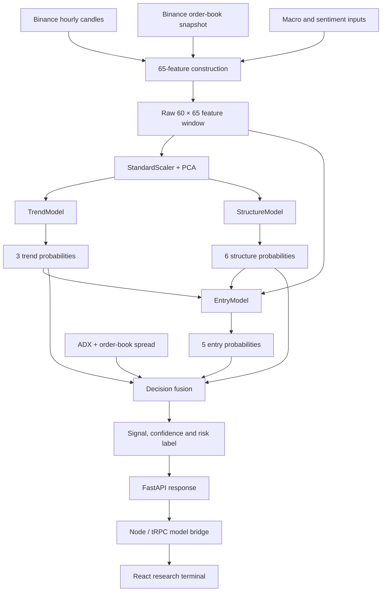
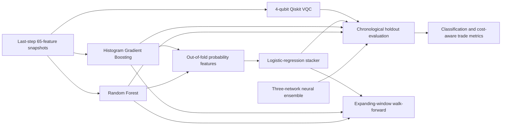

# QuantGrad

QuantGrad is a market-research platform built around a three-network neural inference pipeline and a separate model-comparison suite. It combines hourly exchange data, order-book context, market-structure features and macroeconomic inputs, then presents the resulting analysis in a local web terminal.

The project is experimental research software. It does not connect to exchange accounts, place orders or provide investment advice. The performance figures written to a training report are outputs of the configured experiments, not evidence of dependable future returns.

## At a glance

| Component | Implementation |
|---|---|
| Market inputs | Binance Spot OHLCV candles and order-book depth |
| Macro inputs | Yahoo Finance, FRED (optional key), Alternative.me and CoinGecko |
| Feature matrix | 65 features across seven groups |
| Sequence length | 60 hourly observations |
| Main neural models | TensorFlow/Keras TrendModel, StructureModel and EntryModel |
| Experimental comparators | Qiskit four-qubit variational classifier, Random Forest, Histogram Gradient Boosting and logistic-regression stacker |
| Model service | Python, FastAPI |
| Web application | React 19, TypeScript, Vite, Express and tRPC |
| Evaluation | Chronological holdout, validation-selected confidence thresholds, ATR-based trade simulation and expanding-window tests for the classical baselines |

## Architecture

QuantGrad has two runtime services. The Python service owns feature construction, model loading, inference and the local evaluation payload. The Node service provides the web application, public-market endpoints and a typed bridge to the Python API.

### Live inference

The live prediction path consists of three separate neural networks. Trend and structure are predicted independently; their probability vectors then become inputs to the EntryModel alongside the original feature window.



| Network | Input | Architecture | Output |
|---|---|---|---|
| **TrendModel** | 60-step PCA-transformed sequence | Causal Conv1D blocks, stacked LSTMs, four-head self-attention, residual normalisation and global average pooling | 3 classes: uptrend, downtrend, ranging |
| **StructureModel** | Same PCA-transformed sequence | Convolutional residual blocks, stacked LSTMs and a temporal attention gate | 6 classes: bullish/bearish market-structure shift, order block, fair-value gap, liquidity sweep and none |
| **EntryModel** | Original 60 × 65 sequence, 3 trend probabilities and 6 structure probabilities | Seven parallel feature-stream branches; each uses Conv1D, a residual projection and an LSTM. A separate context branch processes the trend and structure probability vectors | 5 classes: strong buy, buy, hold, sell and strong sell |

The EntryModel branches correspond to gradient, momentum, volume, structure, trend, technical and macro features. The final `fusion_decision()` function is a separate rule-based stage: it combines the three networks' probabilities with ADX and order-book spread to produce the displayed signal, confidence, trend, structure and risk label.

### Offline model-comparison suite

The trainer also evaluates models that do not form additional stages in the live inference chain.



- **QuantumMarketClassifier** is a supervised, four-qubit variational classifier. It reduces the tabular input to four PCA components and evaluates a Qiskit `Statevector` circuit for three-way directional classification.
- **Random Forest** and **Histogram Gradient Boosting** are classical tabular baselines trained on the final feature row from each sequence window.
- **Tree stacker** is a logistic-regression meta-model trained on expanding-window out-of-fold probability outputs from the two classical baselines.
- **Neural ensemble** refers to TrendModel, StructureModel and EntryModel operating together. Its five entry probabilities are collapsed into down, flat and up probabilities for the three-class comparison.

The chronological holdout comparison includes the neural ensemble, Qiskit classifier, both tree baselines and the stacker. The expanding-window walk-forward routine currently evaluates the Random Forest, Histogram Gradient Boosting and stacker; it does not run walk-forward folds for the neural or quantum model.

#### The two quantum-related components are not interchangeable

`QuantumPreprocessor` contains a PCA stage and an optional `QuantumFeatureMap`. The live TrendModel and StructureModel inference path uses the scaler and PCA output; it does not consume the feature-map output. In the checked-in training report, PCA retains 34 components, while the local statevector feature-map implementation has a 12-qubit limit. That configuration therefore uses the feature-map's classical fallback. The separate four-qubit `QuantumMarketClassifier` is the Qiskit statevector classifier used in the model-comparison suite.

No experiment in this repository runs on quantum hardware, and the code does not establish a quantum advantage.

## Feature engineering

The feature builder combines seven groups into a 65-column matrix.

| Group | Count | Included signals |
|---|---:|---|
| Gradient and price dynamics | 8 | Gradient, acceleration, jerk, persistence and normalised gradient |
| Multi-scale momentum | 6 | 5/20/50-period ROC, alignment and divergence |
| Volume and order flow | 8 | Volume delta and z-score, spikes, VWAP deviation, taker-buy ratio and order-book measures |
| Market structure | 17 | Swing points, market-structure shifts, trend structure, order blocks, fair-value gaps, liquidity sweeps and premium/discount position |
| Trend strength | 9 | ADX, directional indicators, EMA alignment, VWAP position and ADX slope |
| Technical indicators | 7 | RSI, MACD, Bollinger measures, log return and mid-price normalisation |
| Macro context | 10 | DXY, gold and crude correlations/momentum, Fear & Greed, BTC dominance, Fed rate and FOMC flag |
| **Total** | **65** | |

The model window contains 60 consecutive observations. The feature schema and stream boundaries are shared by training and inference; the EntryModel slices the raw 65-feature sequence by those boundaries.

### Data sources

The Python feature pipeline uses:

- **Binance Spot:** hourly klines and a current order-book depth snapshot.
- **Yahoo Finance:** DXY (`DX-Y.NYB`), gold futures (`GC=F`) and WTI crude futures (`CL=F`).
- **FRED:** effective federal funds rate. A `FRED_API_KEY` is optional; the fetcher uses a documented fallback when it is absent or the request fails.
- **Alternative.me:** Crypto Fear & Greed Index.
- **CoinGecko:** BTC market dominance.

Daily macro series are aligned to the hourly index by forward-filling. The macro fetcher stores its result in `backend/data/macro_cache.json` and warns when the cache is older than 24 hours. Provider failures can result in fallback values; the training report records some of those fallback states.

The web application has its own public-data layer. It uses Binance Spot for quotes, movers and candles; Binance USDⓈ-M Futures for funding, open interest and account ratios; Hyperliquid for public market and wallet context; and Google News RSS for headlines. The web Macro page currently displays a curated FOMC event list rather than a live economic-data feed.

## Repository layout

`QuantGrad_V5_Complete/` is the active application directory.

```text
.
├── README.md
├── QuantGrad_V5_Complete/
│   ├── backend/
│   │   ├── artifacts/              # Model and preprocessing artifacts
│   │   ├── data/                   # Macro cache
│   │   ├── feature_engine.py       # Market data and 65-feature builder
│   │   ├── market_structure.py     # Structure features and labels
│   │   ├── macro_fetcher.py        # Macro and sentiment data collection
│   │   ├── quantum_layer.py        # PCA, feature-map and VQC components
│   │   ├── strategy_experiments.py # Labels, baselines and trade simulation
│   │   ├── trainer_v3.py           # Model definitions and training workflow
│   │   ├── server.py               # FastAPI inference service
│   │   ├── dashboard.py            # Retained Streamlit dashboard
│   │   └── test_*.py / verify.py    # Backend checks
│   ├── frontend/
│   │   ├── client/src/pages/Home.tsx
│   │   ├── client/src/components/ui/ # Reusable Radix-based UI components
│   │   ├── server/                  # Express, tRPC, public data and model bridge
│   │   ├── shared/                  # Shared model-analysis types
│   │   ├── package.json
│   │   └── pnpm-lock.yaml
│   ├── setup_windows.bat
│   ├── run_backend.bat / .sh
│   ├── run_frontend.bat
│   └── train_quick.bat
└── backend/artifacts/               # Older artifact snapshot; not the active path
```

The repository also contains reusable UI primitives and template/scaffold modules. The current client entry point renders `App.tsx`, which wraps the QuantGrad `Home` page in an error boundary; the other template components are not separate application routes.

The older `backend/dashboard.py` Streamlit interface remains in the source tree, but the supplied V5 launch scripts start the FastAPI service and the React/tRPC application. The top-level `backend/artifacts/` directory is an older snapshot. Use `QuantGrad_V5_Complete/backend/artifacts/` for the current trainer and API.

## Running locally

### Requirements

- Python **3.12**.
- Node.js compatible with Vite 7 (Node 20.19+ or 22.12+).
- pnpm **10.4.1**, as pinned by the frontend package.
- Internet access for market and macro data.
- Enough memory and disk space for TensorFlow, training data and model artifacts.

### Windows

From PowerShell or Command Prompt:

```powershell
cd .\QuantGrad_V5_Complete
.\setup_windows.bat
```

Open two terminals in `QuantGrad_V5_Complete/`.

**Terminal 1 — Python model API**

```powershell
.\run_backend.bat
```

**Terminal 2 — React application**

```powershell
.\run_frontend.bat
```

The frontend normally starts at [http://localhost:3000](http://localhost:3000). If that port is occupied, the Node server checks the next available ports and prints the address it selected. The Python API listens at [http://127.0.0.1:8000](http://127.0.0.1:8000).

### macOS and Linux

From `QuantGrad_V5_Complete/`:

```bash
python3.12 -m venv .venv
source .venv/bin/activate
python -m pip install --upgrade pip
python -m pip install -r backend/requirements.txt
```

Start the Python API in one terminal:

```bash
source .venv/bin/activate
bash run_backend.sh
```

Start the frontend in a second terminal:

```bash
cd frontend
corepack pnpm@10.4.1 install --frozen-lockfile
corepack pnpm@10.4.1 dev
```

Open the frontend address printed by the Node process, normally [http://localhost:3000](http://localhost:3000).

### Optional environment settings

- `FRED_API_KEY` — improves the Fed Funds Rate input. Without it, the macro fetcher uses its configured fallback.
- `QUANTGRAD_MODEL_API_URL` — set in the frontend environment if the Python API is not at `http://127.0.0.1:8000`.

The public market pages do not require exchange API credentials. The optional Zapier integration accepts a user-supplied HTTPS Catch Hook URL for an explicit test event; the application does not persist that URL.

## Training

The checked-in inference artifacts are under `QuantGrad_V5_Complete/backend/artifacts/`. The API expects these six files:

| Artifact | Purpose |
|---|---|
| `trend_model.keras` | Trend classifier |
| `structure_model.keras` | Market-structure classifier |
| `entry_model.keras` | Entry classifier |
| `scaler.pkl` | StandardScaler fitted during training |
| `pca.pkl` | PCA decomposition |
| `quantum_params.pkl` | Quantum feature-map parameters and configuration |

The repository also contains a training report, the best EntryModel weights checkpoint and a saved quantum comparison classifier. The trainer writes the Random Forest, Histogram Gradient Boosting and tree-stacker `.joblib` files locally; those files are ignored by Git.

To run the small training configuration on Windows:

```powershell
cd .\QuantGrad_V5_Complete
.\train_quick.bat
```

That launcher runs `trainer_v3.py --quick --bars 1500`. Quick mode uses five epochs and is intended as a pipeline check, not a final experiment.

For a longer run, activate the Python environment and execute from the backend directory:

```bash
cd backend
python trainer_v3.py --symbol BTCUSDT --bars 20000
```

The trainer uses 60-step windows, fits preprocessing on the training portion, and creates chronological training, validation and test partitions with a 24-bar purge around the boundaries. The default full training configuration uses up to 60 epochs; quick mode uses five.

To keep the existing neural models and run the comparison suite again:

```bash
python trainer_v3.py --symbol BTCUSDT --bars 20000 --compare-existing
```

This mode expects compatible neural and preprocessing artifacts to be present. It trains the small Qiskit comparator and the classical baselines, then updates the comparison sections of `training_report.json`.

Training fetches data from external providers. For a research run, save the exact input data or a provider snapshot, symbol, interval, date range, label configuration, dependency versions, random seeds, training arguments and artifact hashes. The current repository does not provide a fully versioned historical market-data dataset.

## API reference

The Python FastAPI service exposes:

| Method | Endpoint | Description |
|---|---|---|
| GET | `/api/status` | Reports whether the six required inference artifact files exist |
| GET | `/api/analyze` | Fetches market context, runs inference and returns signal, probability, candle, macro, rolling and evaluation data |

`/api/analyze` accepts:

| Parameter | Default | Range |
|---|---:|---|
| `symbol` | `BTCUSDT` | Uppercase exchange symbol, 5–16 characters |
| `bars` | `800` | 300–2,000 hourly bars |
| `windows` | `260` | 80–500 rolling windows |

Example:

```text
http://127.0.0.1:8000/api/analyze?symbol=BTCUSDT&bars=800&windows=260
```

The Node application exposes the browser-facing procedures under `/api/trpc`. Its `market` router provides overview, candles, movers, derivatives, Hyperliquid, public wallet, macro calendar, news and local-model analysis procedures. The model bridge checks `/api/status` before requesting `/api/analyze`, and reports an explicit unavailable state if the Python service or artifacts are missing.

The Python API's status endpoint checks filenames only. It does not validate model quality, artifact compatibility or successful deserialisation. Only load artifacts produced by a trusted QuantGrad training run.

## Web application

The current React client contains eight views:

- **Terminal** — spot-market overview, movers, model decision ledger and available model-performance results.
- **Discover** — public market movers and attributed news headlines.
- **Charts** — Binance candles with candle, line and Heikin-Ashi display modes.
- **Strategy Lab** — a local rule composer for manual review. It does not run a backtest or place orders.
- **Derivatives** — Binance USDⓈ-M Futures funding, mark price, open interest and global account ratios.
- **Macro** — a curated FOMC calendar and recent market headlines.
- **Flow** — Hyperliquid market context and positions visible at a supplied public wallet address.
- **Integrations** — an explicit test event to a user-supplied Zapier Catch Hook.

The chart surface is drawn in the client with SVG; Recharts is used for model-comparison and strategy-result visualisations. Public-data responses are cached briefly and carry source and availability information. The interface remains visible when a public feed or the local model service is unavailable.

## Tests and validation

Run the focused Python strategy tests from `QuantGrad_V5_Complete/backend/`:

```bash
python -m unittest test_strategy_experiments -v
python test_fomc_smoke.py
```

`test_analyze.py` is a live integration script: it calls the analysis endpoint directly and requires working model artifacts, internet access and the Python dependencies.

Run frontend checks from `QuantGrad_V5_Complete/frontend/`:

```bash
pnpm check
pnpm test
pnpm build
```

The frontend test suite covers the local-model bridge, public-data normalisation and validation, model presentation helpers, and logout behaviour. These tests exercise application contracts; they do not establish predictive performance or validate the trading simulation against live execution.

## Research notes and limitations

QuantGrad is a useful base for further experiments, but the current implementation should not be described as a leakage-free or fully reproducible trading study without additional work.

- **Point-in-time features need an audit.** The feature code uses `numpy.gradient` for price derivatives and future-window comparisons in swing-point detection. The order-block detector also confirms a pattern using later candles before assigning its active interval. These operations can make information from later observations available at earlier timestamps. They should be made causal or shifted to the time they become observable, followed by a complete retraining and re-evaluation, before making out-of-sample claims.
- **The purge does not remove feature leakage.** The trainer applies a 24-bar purge between chronological partitions to account for the configured maximum holding period. That is useful for overlapping labels, but it cannot correct features that already contain future information.
- **Walk-forward coverage is partial.** The current expanding-window routine covers the classical baselines and their stacker, not the neural ensemble or Qiskit classifier.
- **Backtests are simplified.** The variable-exit simulator models next-open entries, ATR stop/target levels, model HOLD/reversal exits, a maximum holding period, fees and slippage. It does not model every aspect of spread, market impact, partial fills, exchange outages or funding payments.
- **Data and training are not fully pinned.** Market data is fetched from external providers, some Python dependencies are not version-pinned, and the trainer does not establish a complete deterministic seed/configuration record for every model.
- **Fallback macro inputs matter.** A run with provider fallback values is not directly comparable to a run with complete live macro series. Check `macro_status` in the training report.
- **Quantum simulation is local.** The comparison classifier uses Qiskit Statevector simulation. The preprocessor's feature-map path can fall back to a classical transform and is not part of the live neural inference input.
- **No order execution exists.** Strategy Lab is a specification interface; the other market views are informational. No exchange credentials or trading endpoints are used.
- **Licensing is not settled at repository level.** The frontend package declares an MIT package license, but the repository does not contain a root-level LICENSE file.

For a paper, report the exact model and data version, target definition, time boundaries, purge policy, threshold-selection procedure, execution assumptions, macro-source status and artifact hashes. Compare the quantum model with appropriately tuned classical baselines under the same splits and comparable tuning budgets. Do not interpret a single quick-training report as evidence of generalisable performance.

## Citation

When the research paper has a stable title, author list and public identifier, add its formal citation here. Until then, cite the exact repository revision and include the commit hash used to generate each experiment.
