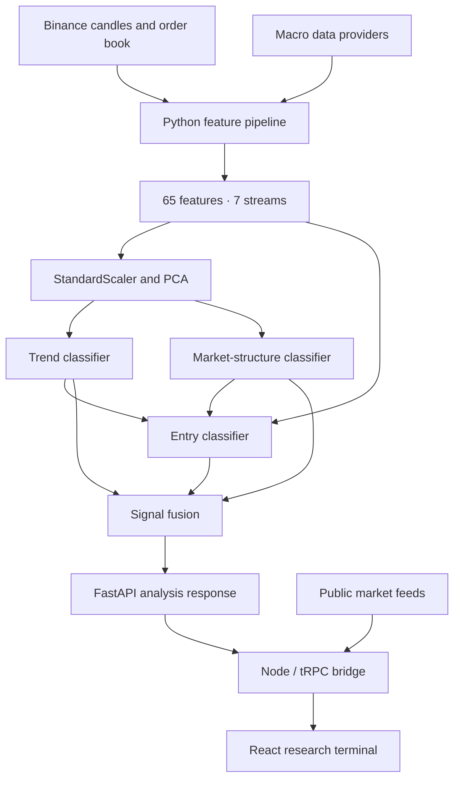

# QuantGrad

**A research-oriented market analysis platform combining multi-stream feature engineering, neural sequence models, quantum-model experiments, and a browser-based research terminal.**

QuantGrad is an experimental software project for studying how technical, market-structure, order-book, and macroeconomic information can be brought together in a common market-analysis pipeline. It includes a Python training and inference service, a React/TypeScript interface, and a set of model-comparison and backtesting experiments.

The repository is intended to support ongoing research and reproducible technical review. It is **not** a trading service, financial product, or evidence that any model can generate reliable returns.

## Project at a glance

| Area | Implementation |
|---|---|
| Market data | Binance spot OHLCV candles and order-book snapshots |
| Feature engineering | 65 features organised into seven streams |
| Sequence models | TensorFlow/Keras trend, structure, and entry classifiers |
| Dimensionality reduction | Standard scaling and PCA |
| Quantum experiments | Qiskit statevector-based feature processing and a separate variational classifier |
| Classical comparisons | Random Forest, Histogram Gradient Boosting, and an out-of-fold tree stacker |
| Evaluation | Chronological holdout, confidence-threshold selection, transaction-cost-aware simulation, and expanding-window walk-forward experiments |
| Python service | FastAPI |
| Web application | React 19, TypeScript, Vite, Express, and tRPC |

## How the system is organised

The project has two cooperating services:

1. **Python model service** — retrieves market inputs, constructs the feature matrix, loads trained artifacts, runs model inference, and returns the analysis payload.
2. **Web application** — provides the research terminal and public-market context panels. Its server bridges requests to the local Python service when model analysis is requested.



The diagram describes the intended data flow. The separate quantum-classifier and classical-baseline experiments are part of the training/evaluation workflow; they are not all sequential stages in the live inference path.

## Repository layout

The runnable project is maintained in `QuantGrad_V5_Complete/`. The older top-level `backend/artifacts/` directory is a separate artifact snapshot; the supplied launch scripts and Python modules use `QuantGrad_V5_Complete/backend/artifacts/`.

```text
.
├── README.md
├── QuantGrad_V5_Complete/
│   ├── backend/
│   │   ├── artifacts/          # Trained models and preprocessing artifacts
│   │   ├── data/               # Macro-data cache
│   │   ├── feature_engine.py   # Market inputs and 65-feature construction
│   │   ├── market_structure.py # Structure features and labels
│   │   ├── macro_fetcher.py    # External macro-data collection
│   │   ├── quantum_layer.py    # PCA and Qiskit-based experiments
│   │   ├── trainer_v3.py       # Model training and evaluation orchestration
│   │   ├── strategy_experiments.py
│   │   ├── server.py           # FastAPI model API
│   │   └── test_*.py           # Backend tests
│   ├── frontend/
│   │   ├── client/src/         # React application
│   │   ├── server/             # Express, tRPC, public-data and model bridge
│   │   ├── shared/             # Shared TypeScript types and model schemas
│   │   ├── package.json
│   │   └── pnpm-lock.yaml
│   ├── setup_windows.bat
│   ├── run_backend.bat
│   ├── run_frontend.bat
│   └── train_quick.bat
└── backend/
    └── artifacts/              # Legacy/duplicate artifact snapshot
```

## Feature design

The Python pipeline builds a 65-column feature matrix from seven groups. The feature contract is shared by training and inference.

| Stream | Features | Examples |
|---|---:|---|
| Gradient and price dynamics | 8 | Gradient, acceleration, jerk, persistence |
| Multi-scale momentum | 6 | ROC at multiple horizons, momentum alignment, divergence |
| Volume and order flow | 8 | Volume z-score, VWAP deviation, taker-buy ratio, order-book measures |
| Market structure | 17 | Swing points, market-structure shifts, order blocks, fair-value gaps, liquidity sweeps |
| Trend strength | 9 | ADX, directional indicators, EMA alignment, VWAP position |
| Technical indicators | 7 | RSI, MACD, Bollinger features, log return |
| Macro context | 10 | DXY, gold and crude relationships, macro momentum, sentiment and policy inputs |
| **Total** | **65** | |

The model window is 60 time steps. The trend task uses three classes, the market-structure task uses six classes, and the entry task uses five signal classes.

## Models and experiments

### Neural sequence pipeline

The live model path is built around three TensorFlow/Keras models:

- **Trend model** — classifies the prevailing trend as uptrend, downtrend, or ranging.
- **Structure model** — classifies market-structure events, including bullish/bearish shifts, order blocks, fair-value gaps, liquidity sweeps, and a no-event class.
- **Entry model** — combines the feature sequence with the trend and structure probability outputs to produce a five-class entry signal.

The trainer defines temporal convolution and recurrent components, attention mechanisms, residual connections, regularisation, and label smoothing. The model outputs are passed through a shared signal-fusion function.

### Quantum and classical comparisons

The research code also contains experiments beyond the three-model inference chain:

- A PCA-based preprocessing path and a Qiskit statevector feature map.
- A separate four-qubit variational quantum classifier for directional classification.
- Random Forest and Histogram Gradient Boosting baselines.
- A logistic-regression meta-model trained from expanding-window out-of-fold baseline probabilities.

**Quantum terminology matters here:** the supplied quantum routines use local statevector simulation. The feature-map implementation can fall back to a deterministic classical transform when Qiskit is unavailable or the configured statevector limit is exceeded. This repository does not demonstrate execution on quantum hardware, nor does the presence of a quantum component establish a quantum advantage.

### Evaluation

The training and strategy code includes:

- Chronological train, validation, and test partitions.
- A purge interval around partition boundaries for the configured maximum holding period.
- Validation-based confidence-threshold selection.
- Classification measures such as accuracy, macro precision/recall/F1, balanced accuracy, and log loss.
- Simulated strategy measures including net return, profit factor, win rate, drawdown, holding time, fees, and slippage.
- Expanding-window walk-forward evaluation for the classical baselines and stacker.

These are software evaluation procedures, not guarantees of out-of-sample performance. Reported values depend on the selected symbol, date range, data availability, labels, execution assumptions, and saved training artifacts. Results should be independently reproduced before being used in a paper.

## Web application

The browser application is organised around a set of research and market-context views:

- **Terminal** — local model status, signal details, and model evidence.
- **Discover** — public market movers and attributed news headlines.
- **Charts** — exchange candles with candle, line, and Heikin–Ashi views.
- **Strategy Lab** — a rule-specification workspace; it does not execute or backtest the displayed draft.
- **Derivatives** — exchange-specific funding, open interest, and long/short account ratios.
- **Macro** — an event calendar and market-news context.
- **Flow** — public Hyperliquid market context and optional public-wallet position lookup.
- **Integrations** — an optional Zapier Catch Hook test.

The frontend obtains public market data from Binance and Hyperliquid, and headlines from a Google News RSS search feed. The Python pipeline separately uses Binance and macro-data providers including Yahoo Finance, FRED (optional API key), Alternative.me, and CoinGecko. Provider availability and fallback values can affect the resulting feature inputs.

## Getting started

### Requirements

- Python **3.12** is the recommended version for the pinned TensorFlow/Python dependency set.
- Node.js and npm.
- pnpm **10.4.1** (the Windows launcher invokes this version through `npx`).
- Internet access for public market and macro-data requests.
- Sufficient memory and disk space for TensorFlow, model artifacts, and training. GPU acceleration is optional; the exact supported GPU setup depends on the local TensorFlow environment.

### Windows

Open PowerShell in the repository and move into the application directory:

```powershell
cd .\QuantGrad_V5_Complete
.\setup_windows.bat
```

Start the Python service in the first terminal:

```powershell
.\run_backend.bat
```

Start the web application in a second terminal:

```powershell
.\run_frontend.bat
```

Then open [http://localhost:3000](http://localhost:3000).

The Python service is available locally at [http://127.0.0.1:8000](http://127.0.0.1:8000). Its readiness endpoint is [http://127.0.0.1:8000/api/status](http://127.0.0.1:8000/api/status).

### macOS and Linux

From `QuantGrad_V5_Complete/`:

```bash
python3.12 -m venv .venv
source .venv/bin/activate
python -m pip install --upgrade pip
python -m pip install -r backend/requirements.txt
```

In one terminal, start the model API:

```bash
cd backend
python -m uvicorn server:app --host 127.0.0.1 --port 8000
```

In another terminal, install and start the web application:

```bash
cd QuantGrad_V5_Complete/frontend
corepack pnpm@10.4.1 install --frozen-lockfile
corepack pnpm@10.4.1 dev
```

Open [http://localhost:3000](http://localhost:3000). If your local Corepack setup does not provide the pinned pnpm version, install pnpm 10.4.1 using your preferred Node.js package-manager workflow.

### Training

The repository currently includes model and preprocessing artifacts under `QuantGrad_V5_Complete/backend/artifacts/`. A new training run is not normally required just to start the application.

To run the small training configuration on Windows:

```powershell
cd .\QuantGrad_V5_Complete
.\train_quick.bat
```

The launcher uses 1,500 hourly BTCUSDT bars and the trainer's quick configuration. Treat this as a pipeline smoke/quick-training run, not as a research-grade experiment or a basis for financial decisions.

For a fuller run, use the trainer's command-line options from the backend directory:

```bash
python trainer_v3.py --bars 20000
```

Training fetches external data and writes model/preprocessing outputs to `backend/artifacts/`. Record the symbol, interval, date range, data snapshot, parameters, dependency versions, and resulting artifact hashes when preparing publishable experiments.

## API

The Python FastAPI service exposes:

| Method | Endpoint | Purpose |
|---|---|---|
| GET | `/api/status` | Checks whether the expected model and preprocessing artifacts are present |
| GET | `/api/analyze` | Fetches market context and runs the local inference pipeline |

The analysis endpoint accepts:

- `symbol` — uppercase exchange symbol; defaults to `BTCUSDT`.
- `bars` — number of hourly candles to request; defaults to 800.
- `windows` — number of rolling windows used for the rolling evaluation payload; defaults to 260.

Example:

```text
http://127.0.0.1:8000/api/analyze?symbol=BTCUSDT&bars=800&windows=260
```

The Node/tRPC application exposes the frontend's public-data and local-model bridge procedures. It is the browser application's primary entry point.

## Tests and checks

Run backend tests from `QuantGrad_V5_Complete/backend/`:

```bash
python -m unittest discover -s . -p "test_*.py" -v
python verify.py
```

Run frontend checks from `QuantGrad_V5_Complete/frontend/`:

```bash
pnpm check
pnpm test
pnpm build
```

The repository contains focused backend tests and frontend tests for selected model-bridge, presentation, and public-data behaviour. Passing these checks does not validate model performance or establish that a backtest is free of methodological bias.

## Research and reproducibility notes

QuantGrad is being developed as a research project. Before treating an experiment as a paper result, document at least:

1. **Research question and hypothesis** — define the claimed contribution before selecting metrics.
2. **Data provenance** — provider, symbol, interval, collection timestamps, missing-data treatment, and any revisions.
3. **Label construction** — thresholds, horizons, barrier definitions, and class balance.
4. **Temporal protocol** — train/validation/test dates, purge or embargo rules, and walk-forward fold boundaries.
5. **Baselines and ablations** — compare against appropriate non-quantum and simpler neural baselines under the same data and evaluation protocol.
6. **Execution assumptions** — fees, slippage, fill timing, spread, position sizing, and treatment of overlapping trades.
7. **Uncertainty** — repeated seeds where feasible, confidence intervals, sensitivity analysis, and statistical tests chosen before interpreting results.
8. **Artifacts** — dependency lockfiles, configuration, raw-data identifiers or snapshots where licensing permits, model hashes, and complete result files.

In particular, a fair quantum-versus-classical comparison requires matched data splits, comparable tuning budgets, transparent simulator settings, and a clear statement of what is quantum and what remains classical.

## Limitations and responsible use

- QuantGrad is a research prototype. It is not financial advice and does not place orders.
- Market and macro feeds are external dependencies; outages, rate limits, revised data, and fallback values can change the inputs.
- The live Python inference route expects compatible trained artifacts. The presence of files is a readiness check, not proof that those artifacts are scientifically valid or compatible with every environment.
- The current code includes local statevector simulation and a classical fallback path; it does not use a quantum processor.
- Backtests are simulations under code-defined assumptions. They do not model every aspect of market impact, liquidity, exchange outages, or real execution.
- The repository does not currently include a root-level license file. Reuse and redistribution terms should be clarified before external adoption.

## Contributing

Changes to the model, feature definitions, labels, evaluation protocol, or artifact format should be accompanied by tests and a description of their effect on reproducibility. Keep experimental outputs separate from source code, avoid committing credentials, and do not present unverified performance claims as established results.

## Citation

A formal citation should be added when the associated paper has a stable title, author list, version, and public DOI or repository release. Until then, cite the specific repository revision used in an experiment and include its commit hash in the paper's methods or supplementary material.

---

*QuantGrad — research software for studying multi-source market representation, model comparison, and evaluation.*
